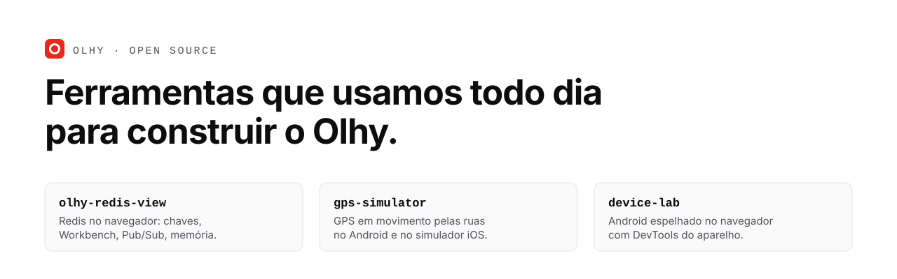
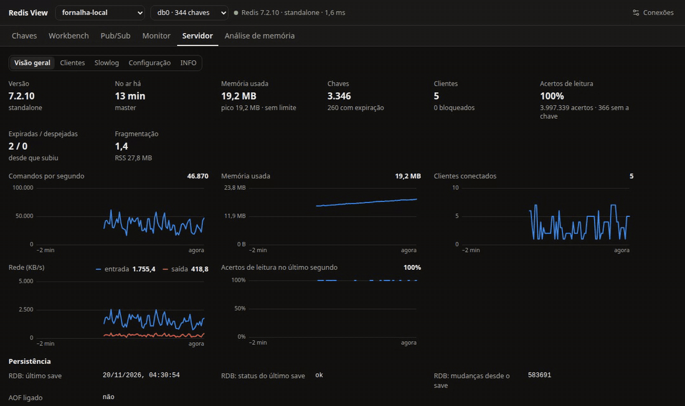
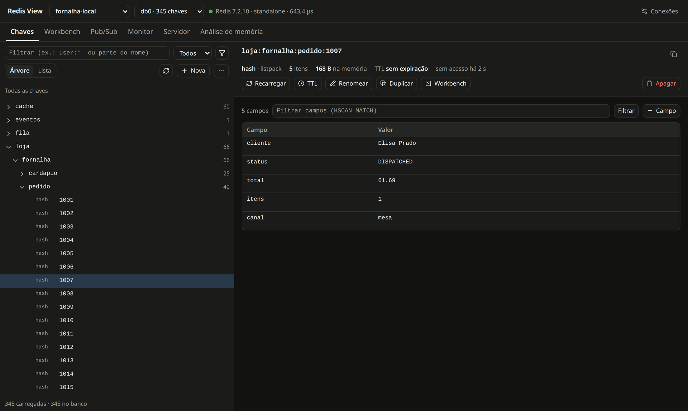
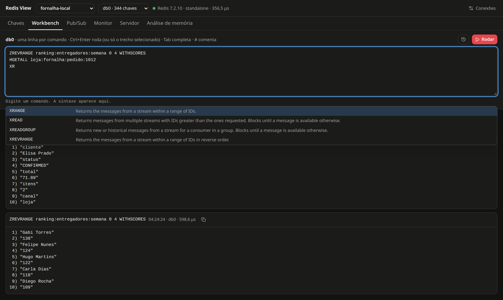
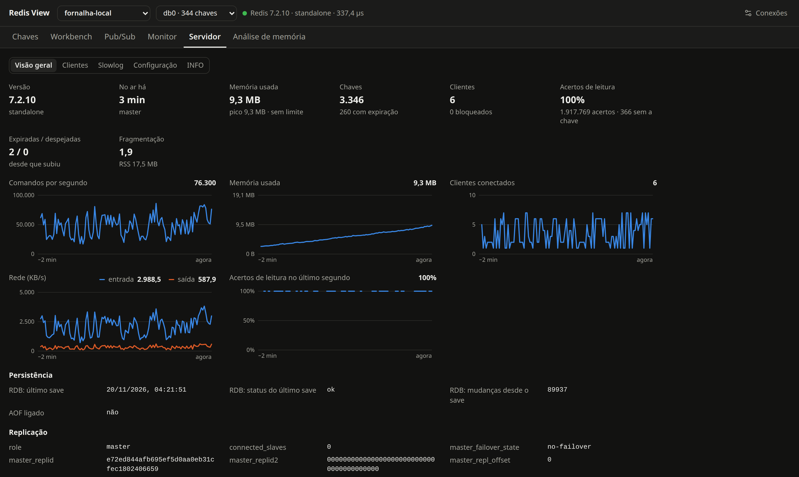
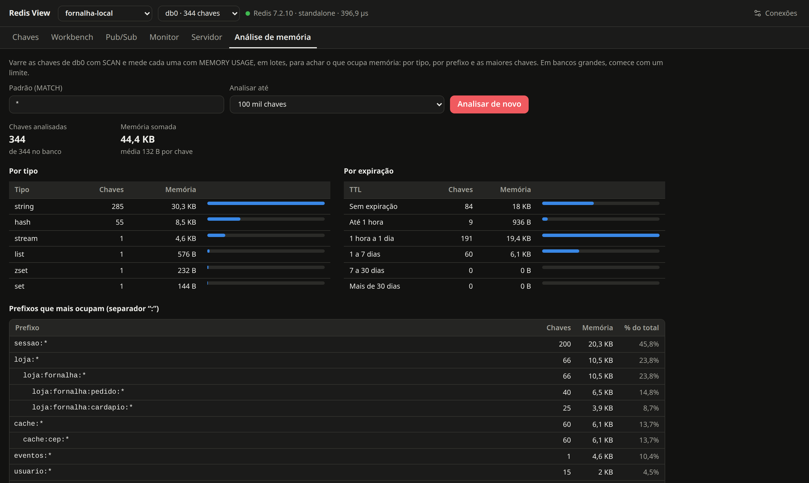
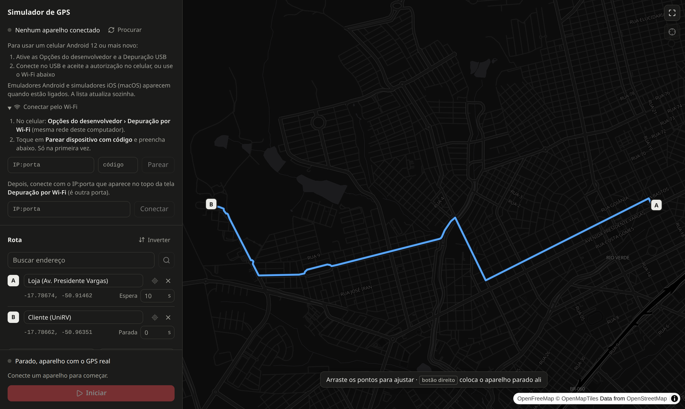
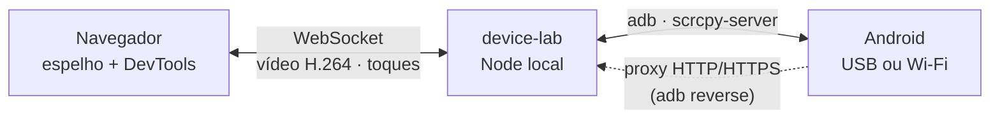

<picture>
  <source media="(prefers-color-scheme: dark)" srcset="https://github.com/olhy-services/.github/raw/main/profile/assets/banner-dark.svg">
  
</picture>

<p>
  <a href="https://olhy.com.br"></a>
  <a href="mailto:contato@olhy.com.br"></a>
  
  
</p>

A **Olhy** é uma empresa brasileira de tecnologia. Nosso produto é o **Olhy Food**:
cardápio digital, pedidos, delivery, PDV, cozinha e app do entregador para
restaurantes.

Para construir tudo isso a gente precisou de ferramentas que não existiam do jeito que
queríamos. Elas estão aqui, abertas. Todas seguem as mesmas regras:

- **Rodam no seu computador.** Escutam só em `127.0.0.1`; nada vai para servidor nosso.
- **Não instalam nada no aparelho nem no banco.** Usam o que já existe: `adb`, `xcrun`,
  protocolo do Redis.
- **TypeScript estrito**, sem `any`, entrada validada com Zod, licença MIT.

---

## olhy-redis-view

**Ver, gerenciar e consultar bancos Redis pelo navegador.** Um comando abre a interface;
standalone, Sentinel, Cluster, TLS e túnel SSH. Funciona também com Valkey, KeyDB e
Dragonfly.

<p>
  <a href="https://github.com/olhy-services/olhy-redis-view"></a>
  
  
</p>



<table>
  <tr>
    <td width="50%" valign="top">
      
      <b>Chaves.</b> Árvore pelo separador, <code>SCAN</code> em páginas (nunca <code>KEYS</code>), editor para string, hash, list, set, zset, stream e RedisJSON. Valores como texto, JSON, hex, gzip ou MessagePack, sem corromper binário.
    </td>
    <td width="50%" valign="top">
      
      <b>Workbench.</b> Sintaxe do <code>redis-cli</code>, autocomplete com os comandos do próprio servidor (inclusive módulos), <code>Ctrl+Enter</code> roda o trecho selecionado, histórico por conexão.
    </td>
  </tr>
  <tr>
    <td width="50%" valign="top">
      
      <b>Servidor.</b> Comandos/s, memória, clientes, rede e taxa de acerto ao vivo. Clientes conectados, slowlog, <code>CONFIG</code> e <code>INFO</code> completo.
    </td>
    <td width="50%" valign="top">
      
      <b>Análise de memória.</b> O que ocupa espaço por tipo, por faixa de TTL, por prefixo e as maiores chaves. Um clique abre as chaves daquele prefixo.
    </td>
  </tr>
</table>

Também tem Pub/Sub, `MONITOR`, apagar por padrão com simulação antes, exportar e
importar (`DUMP`/`RESTORE`). Em conexão de **produção**, ação destrutiva pede o nome da
conexão; em **somente leitura**, o servidor bloqueia qualquer escrita, até no Workbench.

```bash
git clone https://github.com/olhy-services/olhy-redis-view.git && cd olhy-redis-view
pnpm install && pnpm build
pnpm start -- redis://127.0.0.1:6379
```

---

## gps-simulator

**GPS em movimento no Android e no simulador iOS.** Marque o ponto A, o B e paradas no
mapa: o aparelho "anda" pela rota **pelas ruas**, na velocidade que você escolher, como
numa entrega de verdade. Todo app do aparelho recebe a posição: o seu app em
desenvolvimento, mapas, app de entrega.

<p>
  <a href="https://github.com/olhy-services/gps-simulator"></a>
  
  
</p>



| | |
|---|---|
| **Aparelhos** | Android 12+ por USB ou Wi-Fi (sem app instalado), emulador Android, simulador iOS no macOS. |
| **Rota** | Busca de endereço, pontos arrastáveis, tempo de espera em cada parada, ida e volta. Rotas reais pelo OSRM. |
| **Movimento** | Velocidade, acelerar o tempo até 20×, ida e volta, precisão e ruído do GPS, deixar parado num ponto com o botão direito. O relógio roda no servidor: fechar a aba não para a simulação. |
| **Cenários** | Salvos em JSON na pasta `scenarios/` e executáveis pela linha de comando (`pnpm sim run cenario.json`), prontos para testes de ponta a ponta. |

```bash
git clone https://github.com/olhy-services/gps-simulator.git && cd gps-simulator
pnpm install && pnpm dev
```

---

## device-lab

**Um Android espelhado no navegador, com o DevTools do aparelho ao lado.** Use o
celular com mouse e teclado e veja, em tempo real, o que ele está fazendo, para
**qualquer app**, não só o seu. Funciona por USB ou Wi-Fi, sem instalar nada no
aparelho.

<p>
  <a href="https://github.com/olhy-services/device-lab"></a>
  
  
</p>

O scrcpy espelha a tela, o Android Studio mostra o profiler, o HTTP Toolkit captura
requisições e o `adb logcat` mostra o log, cada um numa janela. O device-lab junta
tudo numa página:

| Aba | O que mostra |
|---|---|
| **Tela** | Espelho com toque, rolagem, teclado, área de transferência nos dois sentidos, captura em PNG e gravação. |
| **Visão geral** | CPU por núcleo, RAM, rede, temperaturas e bateria (corrente, tensão, saúde). |
| **Desempenho** | Quadros/s do app aberto, % de quadros lentos, p90 do tempo de quadro, CPU e memória. |
| **Rede** | Conexões de todos os apps (dono, servidor, porta) e inspetor de requisições HTTP/HTTPS com "copiar como cURL". |
| **Logcat** | Ao vivo, por nível, com busca e filtro "só o app na tela". |
| **Apps, Arquivos, Processos** | Instalar APK arrastando, navegar pastas (inclusive a privada de apps de debug), encerrar processos. |



```bash
git clone https://github.com/olhy-services/device-lab.git && cd device-lab
pnpm install && pnpm dev
```

---

## Feito com

<p>
  
  
  
  
  
  
  
  
</p>

## Contribuir

Issues e pull requests são bem-vindos. Cada repositório tem um `CONTRIBUTING.md` com
como rodar e testar, e um `SECURITY.md`: falha de segurança vai pelo reporte privado
do GitHub, não em issue pública.

<sub>Olhy Tecnologia · <a href="https://olhy.com.br">olhy.com.br</a></sub>
